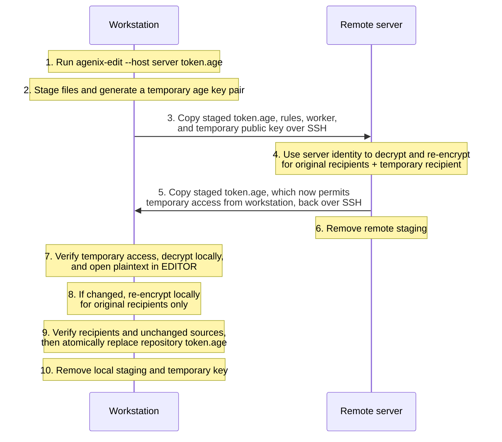

# agenix-helper

[](https://github.com/ruiiiijiiiiang/agenix-helper/actions/workflows/tests.yml)

Read, edit, and rekey agenix secrets using a local or remote host that can decrypt them, without copying host keys to your workstation. To use a remote host, your workstation must have SSH access to it as the user configured in `target`.

**Private keys and plaintext never transfer between hosts.** Rekeying happens on the selected host. Reading and editing generate a fresh local age key for each operation, temporarily grant it access to staged ciphertext, then decrypt on your workstation. Operations run only when invoked, independently of NixOS builds and deployments.

## Typical edit workflow

This example edits an existing secret using one remote server that can decrypt it.



Only encrypted secret content crosses between hosts; editing happens locally, and private keys stay on their respective hosts. The edited secret does not need another trip to the server.

If the plaintext is unchanged, steps 8–9 are skipped and the original `.age` file is preserved byte-for-byte. Failures or cancellation before replacement discard staged changes. Cleanup normally removes temporary files; forceful termination can leave artifacts, and failed SSH cleanup can leave encrypted remote staging.

## Installation

Add the flake input and expose a configured package containing `agenix-read`, `agenix-edit`, and `agenix-rekey`:

```nix
{
  inputs.agenix-helper.url = "github:ruiiiijiiiiang/agenix-helper";

  outputs = inputs@{ nixpkgs, ... }:
    let
      system = "x86_64-linux";
      pkgs = nixpkgs.legacyPackages.${system};
    in
    {
      packages.${system}.agenix-helper = inputs.agenix-helper.lib.mkPackage {
        inherit pkgs;
        rules = "secrets/secrets.nix";
        sources = [ "secrets" "lib/keys.nix" ];
        hosts.server = {
          target = "user@server";
          identity = "/etc/ssh/ssh_host_ed25519_key";
        };
      };
    };
}
```

Install the package with `nix profile add .#agenix-helper`, or add it to your NixOS or Home Manager configuration. Here, `self` refers to your own flake and must be passed into the module if needed:

```nix
# NixOS
environment.systemPackages = [ self.packages.${pkgs.stdenv.hostPlatform.system}.agenix-helper ];

# Home Manager
home.packages = [ self.packages.${pkgs.stdenv.hostPlatform.system}.agenix-helper ];
```

You can also call `inputs.agenix-helper.lib.mkPackage { ... }` directly inside either package list, using the same arguments as above. Once installed, run `agenix-read`, `agenix-edit`, and `agenix-rekey` directly from your secrets repository, or pass `--repo /path/to/repo`. The commands use the rules, sources, and hosts supplied when the package was created.

In flake-parts, set `packages.agenix-helper` inside `perSystem`. `lib.mkPackage` is the only public constructor; configurations using the former `mkApps` or individual app constructors must switch to this package and install it.

**Package parameters**

| Parameter             | Default                            | Purpose                                                                                                                                                    |
| --------------------- | ---------------------------------- | ---------------------------------------------------------------------------------------------------------------------------------------------------------- |
| `pkgs`                | Required                           | Nixpkgs package set for the local system.                                                                                                                  |
| `rules`               | Required                           | Rules file path, relative to the repository used at runtime.                                                                                               |
| `sources`             | Required                           | Nonempty list of repository-relative files/directories to stage. Include the rules, their imports, and encrypted files; exclude symlinks and private keys. |
| `hosts`               | Derived from `nixosConfigurations` | Worker definitions (see below). Explicit values select exactly those hosts; an empty set is invalid.                                                       |
| `nixosConfigurations` | `{ }`                              | NixOS configurations supplying host identity paths. If `hosts` is omitted, every configuration becomes an SSH worker at `root@<configuration-name>`.       |
| `maxConcurrency`      | `10`                               | Maximum simultaneous host workers, including local workers. Must be positive; override with `--max-concurrency COUNT` (`1` for sequential execution).      |
| `name`                | `"agenix-helper"`                  | Package name; commands keep their `agenix-read`, `agenix-edit`, and `agenix-rekey` names.                                                                  |
| `ageRef`              | `"nixpkgs#age"`                    | Flake package reference for age on SSH workers.                                                                                                            |
| `pythonRef`           | `"nixpkgs#python3"`                | Flake package reference for Python on SSH workers.                                                                                                         |

**Host parameters** (`hosts.<name>`)

| Parameter       | Default                                             | Purpose                                                                                               |
| --------------- | --------------------------------------------------- | ----------------------------------------------------------------------------------------------------- |
| `target`        | Required for SSH and `"auto"`                       | SSH destination, such as `"user@server"`. Omit when `local = true`.                                   |
| `local`         | `false`                                             | `false`: SSH; `true`: always local; `"auto"`: local when the runtime hostname matches, otherwise SSH. |
| `localHostname` | Host entry name                                     | Hostname to match for `local = "auto"`; invalid with other modes.                                     |
| `identityPaths` | Matching configuration's `config.age.identityPaths` | Nonempty list of worker private-key path strings. Takes precedence over `identity`.                   |
| `identity`      | Unset                                               | Shorthand for a single worker private-key path, used when `identityPaths` is absent.                  |

At least one host is required. To derive hosts and identities automatically, replace `hosts` in the example with `nixosConfigurations = self.nixosConfigurations;` and bind `self` in the flake's `outputs` arguments. You can also supply configurations alongside explicit hosts to inherit identity paths by matching host name. For aliases, set paths explicitly. Missing or empty identity paths fail evaluation.

Identity paths refer to the executing user's filesystem on each worker: absolute paths, `~` paths, and paths relative to that user's home are accepted. The user must be able to read a key that decrypts the secrets. Private keys stay on their hosts; read/edit generate temporary access automatically and need no user decryption key.

For automatic local selection, set `local = "auto"; target = "user@workstation";`. Matching uses the OS hostname without DNS lookup, ignores case and a trailing dot, and lets `workstation.example.com` match `workstation`. An explicit FQDN in `localHostname` requires a full match. Unreadable local identities fail without falling back to SSH.

SSH workers need `nix`, `tar`, and `mktemp`, plus working noninteractive SSH authentication. Python and age are obtained through `nix shell`; local workers use the bundled runtime. SSH connection failures skip that host with a warning; worker errors still fail the operation.

## Rekey

Run from your secrets repository, or add `--repo /path/to/repo`:

```sh
# Preview without contacting hosts or changing files.
agenix-rekey --host server --all-secrets --dry-run

# Use a local key without SSH.
agenix-rekey --host localhost --all-secrets

# Select specific hosts, or all configured hosts.
agenix-rekey --host server --host localhost --all-secrets
agenix-rekey --all-secrets

# Rekey only selected secrets.
agenix-rekey --host server nested/token.age other.age
```

Secret paths are relative to the rules file's directory and must name existing rules. Specify secret paths to rekey specific secrets, or pass `--all-secrets` to rekey every secret. Omitting both secret paths and `--all-secrets` produces an error; `--all-secrets` cannot be combined with secret paths. Omitting `--host` selects all configured hosts in sorted order; repeated `--host NAME` restricts selection and preserves submission order. Host workers run concurrently, so completion order may differ. Host selection is independent of secret selection. The former `--all` flag has been removed; remove it from existing commands and keep `--all-secrets` where needed.

Selected hosts are validated before processing. Missing local identities and worker errors abort the operation. SSH connection failures skip the affected host with a warning.

Each host re-encrypts its independent copies of the files it can decrypt. After merging results, `agenix --check` must confirm every selected secret has the declared recipients before any repository files are updated. Only selected ciphertext is checked and copied back; unrelated missing secrets or recipient mismatches do not block targeted runs.

Before copying back, the helper checks that local sources have not changed. Failures before this copy leave the repository untouched; a failure during the copy can leave some files updated. Failed SSH cleanup may leave encrypted files in a remote temporary directory. Review the diff before committing or deploying; the helper does neither automatically.

## Read

Run from your secrets repository; no local decryption identity is needed:

```sh
# Read a single secret (plain decrypted bytes to stdout)
agenix-read --host server nested/token.age

# Read multiple secrets
agenix-read --host server nested/token.age other.age

# Read every secret accessible to the selected hosts
agenix-read --all-secrets
```

With `--all-secrets`, the helper prints every secret that the selected hosts can decrypt and reports the number skipped on standard error. For example, `--host server --all-secrets` reads only secrets accessible to that server. Multiple hosts contribute their accessible secrets. If no secrets are readable, the command fails with empty standard output. Explicit secret paths require every requested secret to be readable before any plaintext is printed.

The helper generates an ephemeral native age key pair and adds its public recipient to the staged rules. Each selected host independently re-encrypts the secrets it can decrypt in one worker run. As results arrive, the helper verifies temporary access for every candidate secret by decrypting to `/dev/null` and merges verified ciphertext. It then decrypts the readable secrets locally and discards staging. The private key never enters any directory transferred to workers. Repository rules and ciphertext remain unchanged.

Local staging is created directly under `/tmp` (ignoring `TMPDIR`), with a `0700` directory and a `0600` private-key file. Normal completion, errors, and handled cancellation remove staging and the key. `SIGKILL` or power loss can leave artifacts; reboot clears them when `/tmp` is tmpfs, while disk-backed `/tmp` depends on system cleanup. The helper does not require `/tmp` to be tmpfs.

When reading a single secret, standard output contains only decrypted bytes without headers. When reading multiple secrets or using `--all-secrets`, each secret is printed with a `==> path.age <==` header and separated by a blank line. Progress and diagnostics go to standard error. Piping and redirection are supported.

Read and edit share these requirements:

- Omit `--host` to select all configured workers, or restrict selection with repeated `--host NAME` arguments. Workers run concurrently up to `maxConcurrency` or `--max-concurrency`. At least one reachable selected host must be able to decrypt each required secret to grant access to the fresh ephemeral key.
- Reading accepts one or more secret paths relative to the rules directory, or `--all-secrets` to read all secrets (omitting both produces an error). Editing accepts exactly one secret path. Supported path characters are letters, numbers, underscores, dots, slashes, and hyphens.
- Original recipients for selected secrets must still be SSH keys. The temporary native age recipient is verified through decryption; final original recipients are verified with `agenix --check`. Unrelated secrets' recipient mismatches do not block the operation.
- `--dry-run` evaluates the rule and checks paths without generating a key, contacting hosts, or decrypting anything.

## Edit

Set `EDITOR` and run from an interactive terminal:

```sh
# Edit using a specific host
EDITOR=nvim agenix-edit --host server nested/token.age

# Process all configured hosts concurrently to prepare access
EDITOR=nvim agenix-edit nested/token.age
```

Editing uses the same temporary access workflow as reading, then opens the secret locally with `agenix --edit`. If the plaintext is unchanged after the editor succeeds, the helper discards staging and preserves the original `.age` file byte-for-byte. Otherwise, the helper uses the ephemeral identity to re-encrypt for the original recipients, verifies them, checks that sources have not changed, and atomically replaces only the selected `.age` file. Rules and imported Nix files remain unchanged.

Editor failures, verification failures, source changes, or cancellation before replacement discard staged changes. Forceful termination can leave temporary artifacts, and editors may retain backups. Removing the temporary recipient does not revoke access to intermediate copies; original recipients retain their existing access.

## Development

Contributions are welcome! Feel free to open an issue or submit a pull request.

Use `path:/path/to/your/checkout` as the flake input URL for local development. Run `nix flake update` in the helper checkout to update its locked dependencies.

With Python, age, agenix, Nix, SSH key generation, and tar on `PATH`, run:

```sh
python3 -B -m unittest discover -s tests -v
```

Tests generate disposable keys and secrets, run real age and agenix commands, and simulate SSH locally. They do not contact hosts or build derivations. The packaging check uses `nix eval` and requires access to the Nix daemon.

GitHub Actions runs the test suite in the locked Nix development shell on pushes to `master`, then builds a configured package and checks all three installed commands with `--help`.

`scripts/controller.py` and `scripts/worker.py` are entry points into the standard-library-only `scripts/agenix_helper` package:

| Module          | Responsibility                                        |
| --------------- | ----------------------------------------------------- |
| `cli.py`        | Arguments, validation, and dispatch                   |
| `config.py`     | Typed configuration and identity paths                |
| `staging.py`    | Snapshots, worker bundles, and file replacement       |
| `rules.py`      | Nix rule evaluation and recipient verification        |
| `hosts.py`      | Local execution and SSH transfers                     |
| `operations.py` | Rekey, read, and edit workflows                       |
| `crypto.py`     | Worker identities and age encryption pipes            |
| `process.py`    | Subprocess errors, cleanup, and interruption handling |
